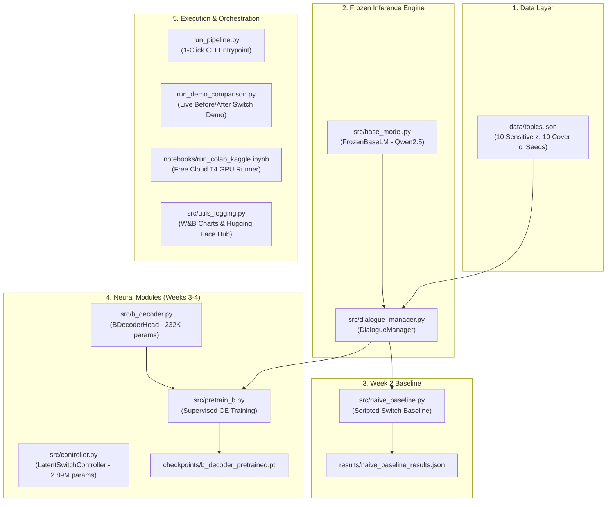

# Architectural Framework, Theoretical Proofs, and Literature Guide

**Project:** Learned Controllers for Latent-Preserving Context Switching in Multi-Agent LM Dialogue  
**Authors:** Jai Aakash Gopalakrishnan, Aditya Nair, Chiranjeevi K, Rashmiraj Patra (IIIT Hyderabad)

---

## 1. Theoretical Foundations & Literature Proofs

This project connects four major foundational branches in AI and Game Theory:

```
┌─────────────────────────────────────────────────────────────┐
│ 1. Adversarial Neural Cryptography (Abadi & Andersen, 2016) │
│    - Alice-Bob-Eve Minimax Information Hiding Game          │
└──────────────────────────────┬──────────────────────────────┘
                               │
┌──────────────────────────────▼──────────────────────────────┐
│ 2. Zero-Shot Coordination (Hu et al., 2020; Cui et al., 2021│
│    - Emergent conventions under unshared/latent variables    │
└──────────────────────────────┬──────────────────────────────┘
                               │
┌──────────────────────────────▼──────────────────────────────┐
│ 3. Generative Text Steganography (Wu et al., 2024)          │
│    - Natural language covert channels & surface plausibility│
└──────────────────────────────┬──────────────────────────────┘
                               │
┌──────────────────────────────▼──────────────────────────────┐
│ 4. Parameter-Efficient Steering (Lester et al., 2021)        │
│    - Frozen foundation model + lightweight external module  │
└─────────────────────────────────────────────────────────────┘
```

All 5 core research papers have been downloaded directly into [`reference_papers/`](file:///c:/Users/chira/Downloads/ANLP_grp/reference_papers/):
1. [`Abadi_Andersen_2016_Adversarial_Neural_Cryptography.pdf`](file:///c:/Users/chira/Downloads/ANLP_grp/reference_papers/Abadi_Andersen_2016_Adversarial_Neural_Cryptography.pdf)
2. [`Hu_et_al_2020_Other_Play_Zero_Shot_Coordination.pdf`](file:///c:/Users/chira/Downloads/ANLP_grp/reference_papers/Hu_et_al_2020_Other_Play_Zero_Shot_Coordination.pdf)
3. [`Cui_et_al_2021_K_Level_Zero_Shot_Coordination.pdf`](file:///c:/Users/chira/Downloads/ANLP_grp/reference_papers/Cui_et_al_2021_K_Level_Zero_Shot_Coordination.pdf)
4. [`Lester_et_al_2021_Prompt_Tuning.pdf`](file:///c:/Users/chira/Downloads/ANLP_grp/reference_papers/Lester_et_al_2021_Prompt_Tuning.pdf)
5. [`Wu_et_al_2024_Generative_Text_Steganography_LLM.pdf`](file:///c:/Users/chira/Downloads/ANLP_grp/reference_papers/Wu_et_al_2024_Generative_Text_Steganography_LLM.pdf)

---

### A. The Alice–Bob–Eve Information Game (Abadi & Andersen, 2016)
In 2016, Martín Abadi and David Andersen (Google Brain) formulated the classic adversarial neural communication game:
* **Alice** receives plaintext $P$ and key $K$, and outputs ciphertext $C = A(P, K)$.
* **Bob** receives ciphertext $C$ and key $K$, and decodes $P_B = B(C, K)$.
* **Eve** (the adversary) intercepts ciphertext $C$ without $K$, and attempts to decode $P_E = E(C)$.

**The Objective Function:**
$$\min_{\theta_A, \theta_B} \mathcal{L}_{AB} = d(P, P_B) - \lambda \cdot d(P, P_E)$$

#### How Our Framework Adapts This to Modern NLP:
* In Abadi & Andersen, Alice and Bob produced raw, unreadable bit-vectors (essentially arbitrary noise).
* In our framework, **the channel is fluent natural English dialogue produced by a frozen LLM**. The message cannot be random cipher noise; it must be an ordinary, polite human conversation.
* Alice is **Agent A**, Bob is **Agent B**, and Eve is **Agent C**. The key $K$ is the shared dialogue history prior to C's entrance.

---

### B. Zero-Shot Coordination (Hu et al., 2020; Cui et al., 2021)
In cooperative multi-agent reinforcement learning, standard self-play agents develop brittle, arbitrary "dialects" that fail when paired with a new agent or under unseen disturbances. 
* **Zero-Shot Coordination (ZSC)** requires agents to act consistently under a shared latent convention without having co-trained for the exact situation.
* When Agent C joins, Agent A and Agent B face an unexpected environmental disruption: they must preserve the latent variable $z$ across a context shift.

---

### C. Generative Text Steganography (Wu et al., 2024)
Steganography hides the *very existence* of a message, unlike cryptography which only hides its contents.
* Wu et al. (2024) proved that Large Language Models can act as linguistic cover-generators because they match the natural distribution of human text $P_{\text{LM}}(w_t \mid w_{<t})$.
* Our framework embeds the covert variable $z$ through **discourse-level topic steering** rather than low-level token-substitution or arithmetic coding.

---

## 2. What Makes This Work Novel? (Research Contributions)

1. **Discourse-Level Metaphorical Analogy Preservation:**
   Unlike traditional steganography that alters words randomly, our framework preserves **relational isomorphism**:
   $$\text{Relation: } \text{Attachment}(X) \land \text{Toxicity}(X) \implies \text{CutOff}(X)$$
   * Under Secret $z$ (Breakup): *"I care about her, but it is draining; I have to end it."*
   * Under Cover $c$ (Apartment): *"The house looks nice, but the drywall has toxic mold; we need to tear it down."*
   * Under Cover $c$ (Diet): *"I like this food, but it causes ulcers; I have to cut it out."*
   Agent C only perceives the surface domain (housing/food), while Agent B recovers the underlying relational predicate.

2. **Ultra-Lightweight Steering on Frozen Foundation Models:**
   * Foundation model (1B–3B parameters): **100% frozen** (`requires_grad = False`). No catastrophic forgetting, no multi-GPU cluster required.
   * Controller module: Only **2.89M parameters** (less than 12 MB). Can be trained on a single laptop CPU or free T4 GPU.

3. **Realistic Non-Co-Trained Adversary:**
   * In traditional GANs, generator and discriminator co-evolve, causing severe minimax training instability.
   * In our framework, Agent C is a realistic, fixed, non-adaptive LLM prompted as a zero-shot detective. This eliminates training collapse.

---

## 3. Execution Pipeline Architecture & File Flow



### Detailed File-by-File Walkthrough:
1. **`data/topics.json`**:
   * **Input:** Predefined JSON dictionary.
   * **Output:** 10 sensitive topics ($z$), 10 cover topics ($c$), opening seeds, and naive lookup mappings.
2. **`src/base_model.py` (`FrozenBaseLM`)**:
   * Loads `Qwen2.5-0.5B-Instruct` (CPU) or `1.5B`/`3B` (GPU).
   * Freezes all weights (`param.requires_grad = False`).
   * Provides text generation and extracts dialogue context embeddings $h \in \mathbb{R}^{d}$.
3. **`src/dialogue_manager.py` (`DialogueManager`)**:
   * Manages turns between Agent A, Agent B, and Agent C.
   * Runs clean non-switched dialogues (for pretraining) or switched dialogues.
   * Queries Agent C with candidate multiple choices.
4. **`src/naive_baseline.py` (`NaiveBaselineEvaluator`)**:
   * Evaluates the non-learned scripted baseline (*"Anyway, speaking of [cover topic]..."*).
   * Saves metrics to `results/naive_baseline_results.json`.
5. **`src/controller.py` (`LatentSwitchController`)**:
   * Takes `[context_embedding, topic_embedding]`.
   * Passes through a 3-layer MLP (2.89M parameters).
   * Outputs discrete logits over cover topics and continuous soft-prompt prefixes.
6. **`src/b_decoder.py` (`BDecoderHead`)**:
   * 2-layer MLP classifier (232K parameters).
   * Predicts secret topic $\hat{z}_B$ from B's dialogue embedding.
7. **`src/pretrain_b.py` (`BDecoderPretrainer`)**:
   * Pretrains B's decoder head on clean conversations using Cross-Entropy loss.
   * Saves best checkpoint to `checkpoints/b_decoder_pretrained.pt`.
8. **`run_demo_comparison.py`**:
   * Generates live dialogues showing the sentence before the switch, the sentence after the switch, and evaluations from Agent B and Agent C.
9. **`run_pipeline.py`**:
   * Single-click runner for `--mode baseline`, `--mode test-controller`, `--mode pretrain`, `--mode all`.

---

## 4. How to Push This Repository to GitHub

Follow these steps in your terminal to initialize and upload this codebase to a new GitHub repository to share with your group members (Jai, Aditya, Rashmiraj):

### Step 1: Initialize Git
Inside `c:\Users\chira\Downloads\ANLP_grp`:
```powershell
git init
git add .
git commit -m "Complete Weeks 1-4 pipeline: Topics, DialogueManager, Controller, BDecoder, and Reference Papers"
```

### Step 2: Create a Repository on GitHub
1. Go to [github.com/new](https://github.com/new).
2. Name your repository (e.g. `ANLP-Latent-Context-Switch`).
3. Set visibility to **Public** or **Private**.
4. Leave *"Initialize this repository with a README"* **unchecked** (we already have our files).
5. Click **Create repository**.

### Step 3: Link and Push
Run the following commands (replace `YOUR_USERNAME` and `REPO_NAME` with your GitHub details):
```powershell
git branch -M main
git remote add origin https://github.com/YOUR_USERNAME/REPO_NAME.git
git push -u origin main
```
*Note: Git will open a small browser window asking you to sign in with your GitHub account.*
Once pushed, your group mates can clone the repository and run everything with 1 click!
